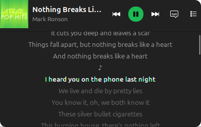

# Spotify mini



Widget pequeño para Linux que se queda **siempre encima** de las demás ventanas y muestra lo que suena en Spotify:

- carátula, canción y artista
- anterior / reproducir-pausa / siguiente
- flechita **⌄** que despliega la barra de progreso (clic o arrastre para adelantar/retroceder), **aleatorio** y **repetir** (lista → canción → no); cerrada no ocupa espacio
- botón de **letra**: sincronizada con la canción (resalta y centra la línea que suena) cuando existe, o texto completo si no
- botón **≡** con las próximas 10 canciones (con su carátula); clic en una para saltar a ella

Hecho con Python + GTK 3. Probado en Ubuntu 26.04 con GNOME (Wayland) y el Spotify de escritorio.

> Proyecto personal, no afiliado a Spotify.

## Requisitos

```bash
sudo apt install python3-gi gir1.2-gtk-3.0
```

Y la app de escritorio de Spotify abierta (snap, deb o flatpak).

## Instalar

```bash
git clone https://github.com/D4rksit3/spotify-mini-widget.git
cd spotify-mini-widget
./install.sh              # o ./install.sh --autostart para que arranque al iniciar sesión
```

Luego ábrelo desde el menú de aplicaciones buscando **Spotify mini**. Para quitarlo: `./uninstall.sh`.

## Uso

- **Mover:** arrastra con clic izquierdo (recuerda la posición).
- **Cerrar:** clic derecho → *Cerrar widget*. Se vuelve a abrir desde el menú de aplicaciones.

## Letras

Salen de [LRCLIB](https://lrclib.net), una base de letras abierta y gratuita; no requiere cuenta ni configuración. El widget le envía título, artista, álbum y duración de la canción que suena para buscarla.

## Ver la cola (opcional)

Spotify no expone la cola al escritorio, solo por su Web API, así que hace falta una app de desarrollador propia:

1. Entra a <https://developer.spotify.com/dashboard> → **Create app**.
2. Redirect URI: `http://127.0.0.1:8898/callback` · API: **Web API**.
3. Copia el **Client ID** (el *secret* no se usa) en `~/.config/spotify-widget/config.json`:

   ```json
   { "client_id": "TU_CLIENT_ID" }
   ```

4. Reabre el widget, pulsa **≡** → **Conectar con Spotify** y autoriza en el navegador.

El inicio de sesión usa PKCE; el token se guarda en `~/.config/spotify-widget/token.json` con permisos `600`.

## Notas

- En Wayland el widget corre como ventana X11 (Xwayland): es la única forma de que GNOME respete "siempre encima".
- Sin Client ID funciona todo menos la cola (las letras no lo necesitan).

## Licencia

MIT
